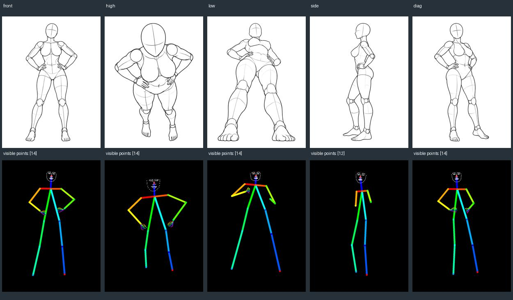
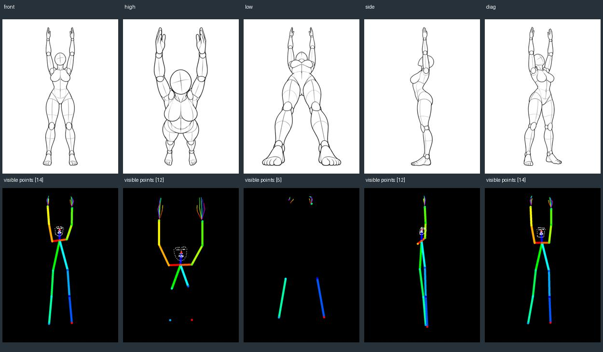
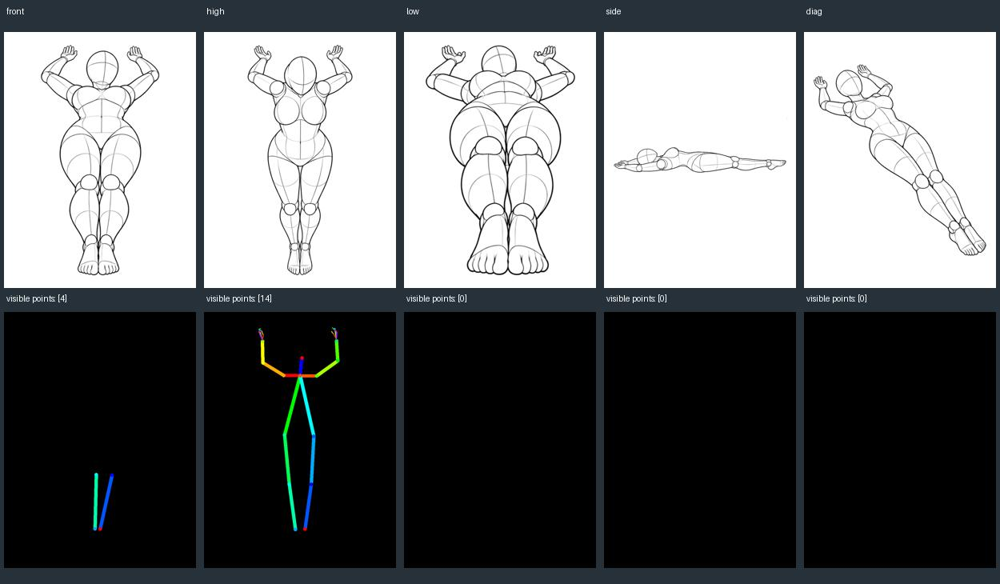
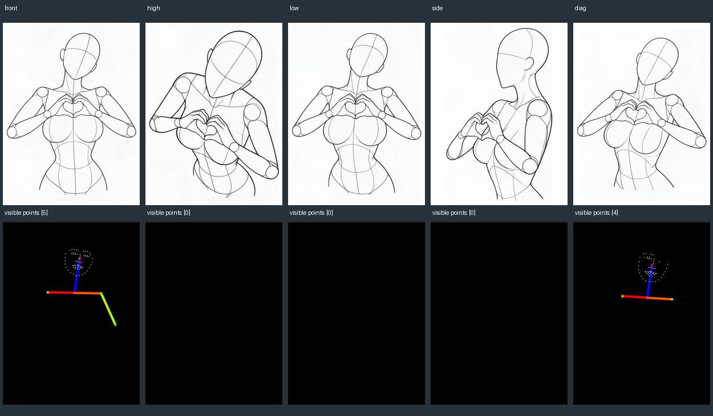
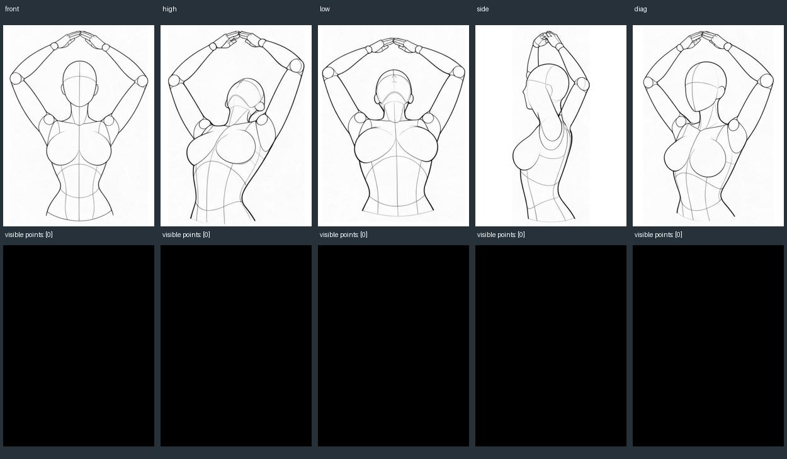

# 图片姿势库验证记录 · v1.8.0

2026-10-29 开始记录，2026-10-31 更新发布与服务验证状态。代码已合并 main，Registry 发布流程成功，[v1.8.0 素材包](https://github.com/T8mars/Comfyui-Qwen-Image-2.1-MultiAngle-T8/releases/tag/v1.8.0) 已公开。程序、资料完整性、生成效果与尚未完成的界面验收分开记录。

## 全量资料

固定源 `anhao/ai-pose-gallery-zh@072a3690af6e7e0011abbe0fa1ccc08939fbb47d`：288 组、1439 个实际视角，1439 原图及 1439 缩略图。逐图解码成功，2878 个文件的 Git blob SHA-1 与固定版本 tree 全部相符；另外保存 SHA-256 清单。完整便携包导出后导入空库，组、视角与图片清单相等。

| 素材包 | 大小 | SHA-256 |
| --- | ---: | --- |
| `AnyAngle-AI-Pose-Gallery-288-groups-1439-views.zip` | 693,904,383 B | `5e893d3299dd27966019816a2ff87419d5e99375a52f5dc8757adc3287e07503` |

原库缺少的 `full_sexy_P018_low` 没有补造；不同来源组的同名动作没有合并。源更新保留已撤回动作的本地副本并标记，保留个人改名和收藏。图片素材不适用本项目 MIT 代码许可，来源说明见[使用文档](image-pose-gallery.md#模型来源与验证范围)。

## 搜索与回归

固定全库样例包括 40 个正例、20 个混淆反例，全部通过；覆盖举手/叉腰等口语、全拼/首字母、多条件 AND、视角、精确 ID、缺失视角、抱臂/抱头、仰卧/俯卧等。最终搜索专项运行中，Node 本地 200 次查询的 p95 约 0.86 ms，低于 50 ms 的逻辑耗时目标；这是纯搜索耗时，不是浏览器渲染耗时。首版不引入 embedding、云服务或向量数据库，后续根据真实失败查询再评估，不能据此宣称理解任意自然语言。

排序复核前，指定样例的前 10 条命中为 36/40（90%）：`坐着`、`单人 坐着`、`后仰`、`抬腿` 指定的动作分别排在第 18、14、18、12 条。修复后，动作名直接命中优先于标签命中，标签优先于宽泛来源分类；动作查询同分时较短标题优先，作为浏览顺序规则，不代表更短名称的姿势一定更相关。显式选择「收藏优先」或「最近应用」时按该选项排序。未移除同词族的其他匹配结果，也未硬编码目标动作 ID。

这一固定开发样例集的 Hit@10 为 **38/40（95%）**，前 24 条均能找到指定动作；`坐着`、`后仰` 的指定动作仍分别排在第 11、15 条。排序方案使用过这组样例，因此这个数字不是独立泛化评测，也不是完整 Recall@10：每个查询只指定一个目标，没有标注所有相关动作。可用人数、画幅或更具体的动作词继续缩小结果。

子 Agent 另从四个来源体系各选 4 个组合查询，在调用搜索引擎前冻结 16 个目标、7 个视角约束和 8 个排除检查。首次验证新旧引擎均命中 15/16，结果集合相同；失败查询 `坐姿 抱膝 后仰` 暴露了「抱单膝」未归入抱膝词族的问题。补上该词族后，原封不动的冻结样例达到 **16/16**，视角与排除检查也全部通过，现已作为回归用例保存。每个组合查询只有 0–3 个候选，这组数据不能证明宽泛搜索的排序收益；修复后的结果也不再视为盲测。

本轮搜索专项 **16/16 测试通过**，包括固定样例、冻结组合查询、名称/标签/分类优先级、显式收藏/最近排序，以及抱单膝与单膝跪的区分。它在下述第二次完整回归之后执行，不冒充又一次全项目回归。

首次完整回归：Python 182/182、JavaScript 294/294。涵盖原有动作与新图库、上传取消/恢复/冲突、路径与链接边界、便携包恢复、预设与收藏夹、用途发送、多人映射、锁定与接触约束、失败回滚、静态图与相机批量隔离、取消回执。后续修改应以最终发布前测试为准。

另用真实图片导出 4,200,797 B 的场景 ZIP，在没有整图库的空存储目录导入；四份资产校验一致，停用动作图及模板保留，发送清单仍为三张启用参考，便携最低版本为1.8.0。

修复了复制人偶后仍处于无引导模式、随机动作来源残留、新检测沿用旧映射、无效映射阻止其他人复制、异步准备时切换选择，以及 Python 3.10 下 Windows junction 识别等问题。

发布准备时另复现并修复：AnyAngle 转图库引导批量误用之前隐藏的 POSE 设置；磁盘写满后遗留临时文件、新任务创建失败阻塞整个任务列表、读取中断任务仍强制写磁盘。相关引导/批量 41 项、图库后端 19 项复测通过；测试环境的 Node 路径改为自动查找后，参考库 22 项复测通过。完整回归数量与上述新增测试分开记录。

以上修复后的第二次完整回归：**Python 185/185、JavaScript 295/295**。这些通过项仍不替代文末列出的真实界面验收。

## 真实 DWPose 提取

使用本机 `yolox_l.onnx` 和 `dw-ll_ucoco_384.onnx`。中性测试图为 `full_single_P019_front`、`upper80v2_P001_front`、`pair60_P051_front`，均为真实图库线稿。

| 样例 | 自动人体检测 | 明确框选后 | 观察 |
| --- | --- | --- | --- |
| 双臂上举 | 未检出 | 14 个可见身体关节 | 全身主要方向可用 |
| 半身手势 | 未检出 | 5 个可见身体关节 | 漏手臂，不足以还原手势 |
| 重叠双人 | 未检出 | 两人，14/13 个关节 | 部分肢体串到另一人，需要手动修点 |

因此加入框选区域和原图标点修正界面。二维线稿没有可靠的三维深度，也不能据 14 个身体点推断完整手指；没有观测到的肢体保留目标当前姿势。

补测中性样例的全部 25 个实际视角：自动检测仅 `full_single_P018_low` 检出人物（1/25）。用整个图片作为明确的单人区域后，14/25 张返回非空身体点。下表只计身体点，不将手指或面部点混入，也不把点数当成准确率。

| 动作 | 正面 | 俯视 | 仰视 | 侧面 | 斜侧 |
| --- | ---: | ---: | ---: | ---: | ---: |
| P018 扶腰 | 14 | 14 | 14 | 12 | 14 |
| P019 双臂上举 | 14 | 12 | 5 | 12 | 14 |
| P049 仰卧 | 4 | 14 | 0 | 0 | 0 |
| P001 胸前比心（半身） | 5 | 0 | 0 | 0 | 4 |
| P002 头顶比心（半身） | 0 | 0 | 0 | 0 | 0 |

逐组对照可见：扶腰仰视有手臂方向错误，举臂俯视漏腿，仰卧只有俯视提取较完整，两个半身手势不能依赖自动结果。下面是实际原图与接口输出组成的检查图，上排原图、下排骨架，均未修补模型结果。这些情况需要在界面内重新框选或手工标点；手工界面的真实交互仍待验收。

查看 25 张源图与实际提取结果

## 实际 Qwen 生成

在本机 ComfyUI 8192 用原生 Qwen Image 2.1 INT8、Qwen3VL INT8、Qwen 2.1 VAE、Euler/simple、20 步、CFG 3、seed 42 运行四个任务。AnyAngle LoRA 强度为 0，没有加载 Turbo LoRA。

其他三张素材分别用于身份、服装和场景；动作图使用新增 `pose` 用途。所有任务均成功完成，实际编码回执均为 4 图，图号、动作用途、受管图片哈希及文本吻合。图库原文件转存 PNG 后的文件哈希不同，逐像素核对一致。输出比例由首张参考或引导图决定，下面实验因此不是保持同画幅的严格消融实验。

| 图库原图 | 动作图为第 4 张参考 | 动作图为首图 | 静态 POSE 引导 + 3 参考 |
| --- | --- | --- | --- |
|  |  |  |  |

- 动作图放在第 4 图：正面、侧面两次都沿用了服装参考中的放下手臂站姿，动作跟随不合格。
- 动作图放在首图：只举起一侧手臂，仍不等于完整复制。
- 将实际提取的 14 点骨架作为第 1 图：跟随了双臂上举，服装与咖啡馆环境同时保留；手指、细节和身份相似度仍属于模型软控制。

这支持操作建议：只想获取灵感可直接添加动作参考；动作要求明确时先核对骨架，再用静态 POSE 或复制到人偶后的 POSE 引导。不能把“4 图已发送”当成“4 个用途完全遵循”。

执行编号：

| 样例 | ComfyUI prompt ID | 实际尺寸 |
| --- | --- | --- |
| 正面作第 4 张参考 | `ef9ab189-cf0f-4c98-bd7a-d507ef9f5acb` | 768×768 |
| 侧面作第 4 张参考 | `056760bd-6f52-4ae4-833f-57b7a28781b2` | 768×768 |
| 正面作首张参考 | `f2ad836e-5e03-4d75-b6ac-928c867a9fd3` | 672×896 |
| 静态 POSE 引导 | `c614c707-f2b7-4e1b-9b8c-5f33f576836a` | 896×1216 |

## 最新服务与发布检查

重新启动最新代码后，ComfyUI 8192 与独立测试页 8194 的图库接口均返回相同的 288 组、1439 个视角。三个中性样例的原图和缩略图均通过文件哈希及解码检查；转存受管 PNG 后 RGB 像素与来源一致。举臂样例使用整图人物区域提取到 14 个身体关节。选定动作组导出的 ZIP 含 5 个视角、10 份图片和清单，图片 SHA-256 全部吻合。测试结束时队列与上传任务列表为空。这些是 HTTP API 检查，不是界面操作证据。

高斯转角修复后完整 JavaScript 回归为 **305/305**；Python 未再次变更，沿用此前 **185/185** 的结果。小角度排序、长距离拖动与尺寸变化绘制时序的修复证据见[高斯转角验证](splat-rotation-validation.md)。

[PR #8](https://github.com/T8mars/Comfyui-Qwen-Image-2.1-MultiAngle-T8/pull/8) 已合并，版本标签 `v1.8.0` 指向 `d7c9ce69e5762c5065a72b43926317582022fe99`。[Registry 发布流程](https://github.com/T8mars/Comfyui-Qwen-Image-2.1-MultiAngle-T8/actions/runs/41218496302) 成功。完整素材包的本地 SHA-256 与 GitHub 资产摘要一致，公开校验清单可下载。

## 尚待完成

浏览器工具仍因无法可靠识别 Windows 浏览器当前 URL 停止操作。因此尚未验证真实界面的中文输入、连续切图、窄窗口、手动框选/点位、多人交互映射、反复打开关闭，以及 ComfyUI 内嵌批量入队、取消和恢复按钮；高斯旋转仍待实际画面检查。单元与 API 检查不能替代这些验收。功能代码与素材已发布，不代表界面全部通过。
