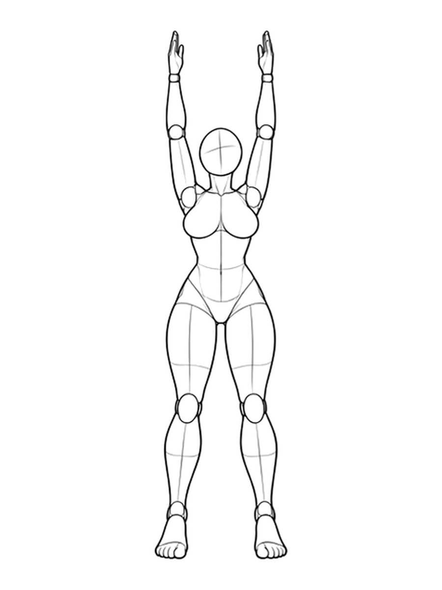
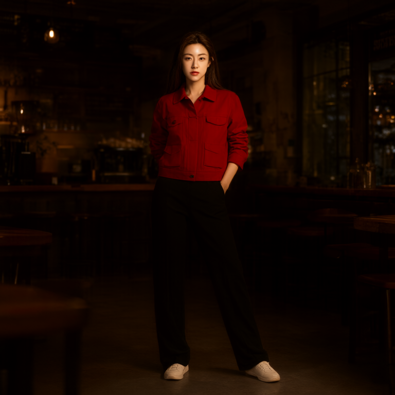
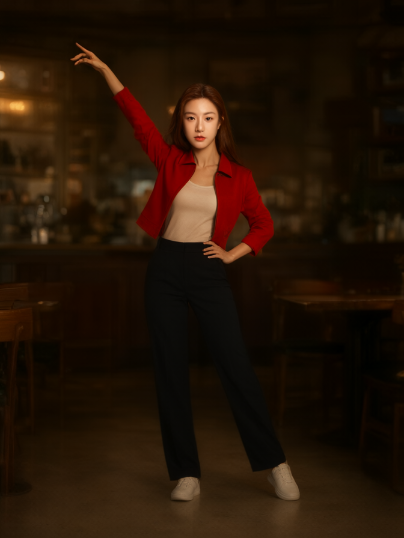
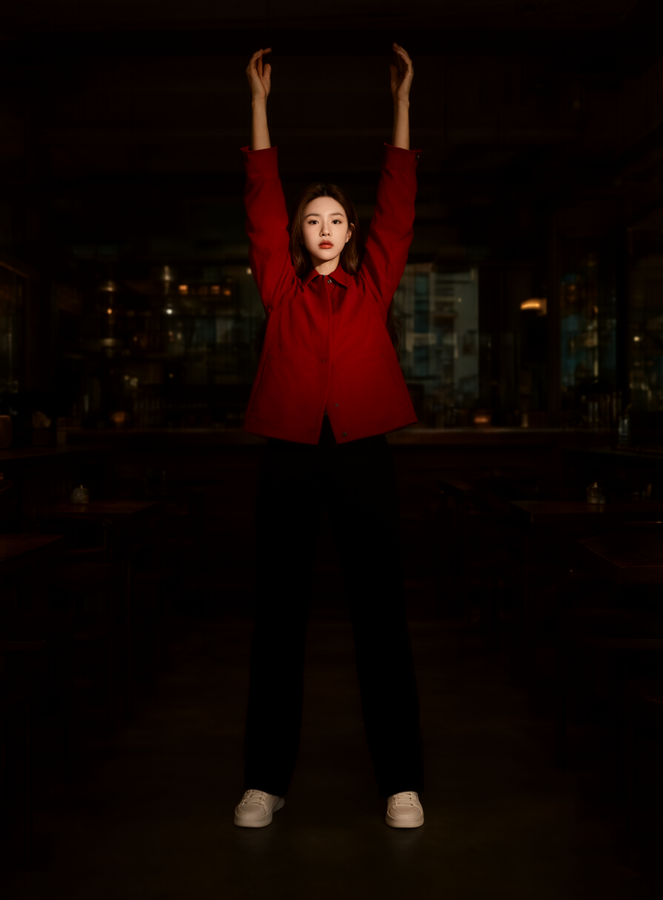

# 图片姿势库验证记录 · v1.8.0

2026-10-29，开发验收中，尚未发布。程序、资料完整性和生成效果分开记录。

## 全量资料

固定源 `anhao/ai-pose-gallery-zh@072a3690af6e7e0011abbe0fa1ccc08939fbb47d`：288 组、1439 个实际视角，1439 原图及 1439 缩略图。逐图解码成功，2878 个文件的 Git blob SHA-1 与固定版本 tree 全部相符；另外保存 SHA-256 清单。完整便携包导出后导入空库，组、视角与图片清单相等。

| 素材包 | 大小 | SHA-256 |
| --- | ---: | --- |
| `AnyAngle-AI-Pose-Gallery-288-groups-1439-views.zip` | 693,904,383 B | `5e893d3299dd27966019816a2ff87419d5e99375a52f5dc8757adc3287e07503` |

原库缺少的 `full_sexy_P018_low` 没有补造；不同来源组的同名动作没有合并。源更新保留已撤回动作的本地副本并标记，保留个人改名和收藏。图片素材不适用本项目 MIT 代码许可，来源说明见[使用文档](image-pose-gallery.md#模型来源与验证范围)。

## 搜索与回归

固定全库金标包括 40 个正例、20 个混淆反例，全部通过；覆盖举手/叉腰等口语、全拼/首字母、多条件 AND、视角、精确 ID、缺失视角、抱臂/抱头、仰卧/俯卧等。Node 本地 200 次查询的 p95 约 0.39 ms；这是纯搜索耗时，不是浏览器渲染耗时。当前金标未显示额外语义模型的必要性，首版不引入 embedding、云服务或向量数据库。未来新增真实失败查询再评估，不能据此宣称理解任意自然语言。

本轮完整回归：Python 182/182、JavaScript 294/294。涵盖原有动作与新图库、上传取消/恢复/冲突、路径与链接边界、便携包恢复、预设与收藏夹、用途发送、多人映射、锁定与接触约束、失败回滚、静态图与相机批量隔离、取消回执。后续修改应以最终发布前测试为准。

另用真实图片导出 4,200,797 B 的场景 ZIP，在没有整图库的空存储目录导入；四份资产校验一致，停用动作图及模板保留，发送清单仍为三张启用参考，便携最低版本为1.8.0。

修复了复制人偶后仍处于无引导模式、随机动作来源残留、新检测沿用旧映射、无效映射阻止其他人复制、异步准备时切换选择，以及 Python 3.10 下 Windows junction 识别等问题。

## 真实 DWPose 提取

使用本机 `yolox_l.onnx` 和 `dw-ll_ucoco_384.onnx`。中性测试图为 `full_single_P019_front`、`upper80v2_P001_front`、`pair60_P051_front`，均为真实图库线稿。

| 样例 | 自动人体检测 | 明确框选后 | 观察 |
| --- | --- | --- | --- |
| 双臂上举 | 未检出 | 14 个可见身体关节 | 全身主要方向可用 |
| 半身手势 | 未检出 | 5 个可见身体关节 | 漏手臂，不足以还原手势 |
| 重叠双人 | 未检出 | 两人，14/13 个关节 | 部分肢体串到另一人，需要手动修点 |

因此加入框选区域和原图标点修正界面。二维线稿没有可靠的三维深度，也不能据 14 个身体点推断完整手指；没有观测到的肢体保留目标当前姿势。

## 实际 Qwen 生成

在本机 ComfyUI 8192 用原生 Qwen Image 2.1 INT8、Qwen3VL INT8、Qwen 2.1 VAE、Euler/simple、20 步、CFG 3、seed 42 运行四个任务。AnyAngle LoRA 强度为 0，没有加载 Turbo LoRA。

其他三张素材分别用于身份、服装和场景；动作图使用新增 `pose` 用途。所有任务均成功完成，实际编码回执均为 4 图，图号、动作用途、受管图片哈希及文本吻合。图库原文件转存 PNG 后的文件哈希不同，逐像素核对一致。输出比例由首张参考或引导图决定，下面实验因此不是保持同画幅的严格消融实验。

| 图库原图 | 动作图为第 4 张参考 | 动作图为首图 | 静态 POSE 引导 + 3 参考 |
| --- | --- | --- | --- |
|  |  |  |  |

- 动作图放在第 4 图：正面、侧面两次都沿用了服装参考中的放下手臂站姿，动作跟随不合格。
- 动作图放在首图：只举起一侧手臂，仍不等于完整复制。
- 将实际提取的 14 点骨架作为第 1 图：跟随了双臂上举，服装与咖啡馆环境同时保留；手指、细节和身份相似度仍属于模型软控制。

这支持操作建议：只想获取灵感可直接添加动作参考；动作要求明确时先核对骨架，再用静态 POSE 或复制到人偶后的 POSE 引导。不能把“4 图已发送”当成“4 个用途完全遵循”。

执行编号：

| 样例 | ComfyUI prompt ID | 实际尺寸 |
| --- | --- | --- |
| 正面作第 4 张参考 | `ef9ab189-cf0f-4c98-bd7a-d507ef9f5acb` | 768×768 |
| 侧面作第 4 张参考 | `056760bd-6f52-4ae4-833f-57b7a28781b2` | 768×768 |
| 正面作首张参考 | `f2ad836e-5e03-4d75-b6ac-928c867a9fd3` | 672×896 |
| 静态 POSE 引导 | `c614c707-f2b7-4e1b-9b8c-5f33f576836a` | 896×1216 |

## 尚待完成

浏览器工具两次因无法可靠识别 Windows 浏览器当前 URL 而停止操作。因此尚未验证真实界面的中文输入、连续切图、窄窗口、手动框选/点位、多人交互映射和 ComfyUI 内嵌批量入队按钮；单元与 API 检查不能替代这些验收。本记录不声称界面全部通过或已经发布。
