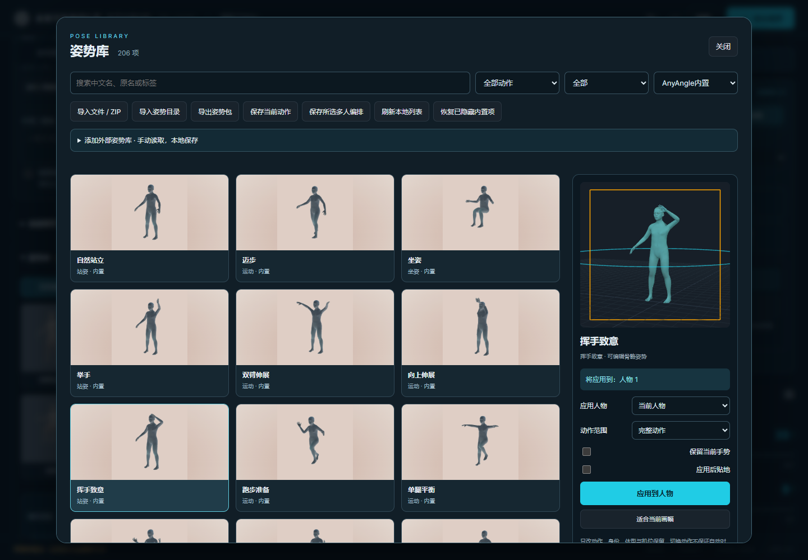

# Shared pose library · v1.7.0 validation

Validated locally on 2026-10-19 with the existing MakeHuman runtime, Python 3.10, Node 22, Chrome and ComfyUI 0.42.0 / frontend 1.55.18. An isolated automated browser used the real local ComfyUI service; it did not operate the user's Chrome profile or replace their open workflow.

**Follow-up:** the [2026-10-20 stability audit](stability-v170-20261020.md) records subsequently reproduced and corrected issues. Its rendered-surface grounding measurement supersedes the coarse bounds measurement below.

## Installed content and distribution

| Catalog | Valid pose records |
| --- | ---: |
| Arekejoker curated source | 55 |
| Totemistyk General | 50 |
| Totemistyk Ballet | 58 |
| MIUProject main | 16 |
| MIUProject extra | 12 |
| Total imported source records | **191** |
| Original built-in poses / two-person compositions | **12 / 3** |
| Actual local catalog total | **206** |

The four external catalogs account for the requested 136 entries. Four JSON catalog indexes are excluded from pose counts. Source revisions and rights are recorded in [THIRD_PARTY.md](../THIRD_PARTY.md). All 191 source entries were installed locally at the user's request; they are not bundled in the public node package. The 15 original entries and their local mannequin previews ship with the node.

Every one of the 206 entries was restored and rendered with the local rig, with finite geometry bounds and a generated PNG preview. This validates loading/rendering, not artistic correctness or absence of intersections in every pose. A 191-entry export including previews was inspected and restored into an empty temporary store, recovering all 191 imported entries plus the 15 built-ins. A real manual pinned-source job fetched the 12-entry MIU extra catalog; the inspection stage did not change the installed catalog revision.

## Automated and interactive coverage

- **263 JavaScript tests** and **156 Python tests** passed. Backend cases include format adaptation, malformed data, ZIP paths/links/duplicates, preview bounds, atomic import, revision conflicts, offline listing, source failure, stable source updates, metadata retention, pose/composition export round trips and original previews on a fresh installation.
- The real editor matrix passed **14 checks**: preview cancellation; four actors with a locked and hidden role; identity/body/placement/lens preservation; exact undo/redo; four guide modes; explicit pose × camera counts; eight real captures; cancellation restoration; shared favorites across independent browser contexts; save/rename/export/delete/restore; handshake composition; custom composition export/inspection; legacy migration retaining its original data; valid/bad file inspection; responsive layout. Related assertions are grouped into these 14 checks in `tests/pose-library-browser.mjs`.
- **2 poses × 4 angles** produced eight distinct guide PNGs. Completion and cancellation restored the original editor scene exactly, including camera target and role identities. Each view gets a fresh rig preparation, so grounding and composition alignment are applied consistently. Existing camera-only behavior remains the default.
- All four **640 × 384** guides were submitted through real **AnyAngleStudioT8 → SaveImage** graphs. Coarse, POSE, depth and Canny output pixels matched their browser captures exactly: maximum RGB channel difference **0** for each image.
- Representative standing, boxing, jumping, walking, floor-seated and one-leg poses were tested on three body profiles: **18 geometry/grounding cases**. Explicit grounding matched the chosen floor within `1e-4` world units. The original handshake spacing exceeded reach in one case; spacing was reduced to four units. The tested equal/different-body wrist gaps then measured below `1e-12` units. This is one-time IK alignment, not collision simulation or a guarantee for arbitrary proportions.
- Existing browser regressions also passed: 14 guide/editor scenarios, 13 viewport widths from 1920 to 320, four distinct fixed-angle captures, preset save/import/export/delete, invalid imports and storage failures, reopening, and angle ranges.

## Performance sample

For the 206-entry catalog on this machine, automated end-to-end timing measured about **255 ms** from opening to the first card, and **133 ms** for the next page. These include browser automation overhead and are not low-end hardware guarantees. Cards are paged in groups of 24 and use lazy-loaded PNGs; only the selected preview has a live renderer.

After closing the library and allowing the workbench to settle, a two-second Chrome DevTools sample observed **zero animation-frame callbacks**, about **0.0016 seconds of main-thread task time**, and about **14.7 MiB used JavaScript heap**. This is a page-main-thread observation, not a measurement of total browser/GPU/system CPU usage.

## Practical limits

Applying an ordinary action preserves role identity bindings, body parameters, world transform, camera and focal length. Grounding and fit-frame are explicit options. Compositions explicitly change the matched roles' relative transforms and require the correct role count; related contacts must be released deliberately. Import/export is data-only and does not run source scripts, prompt recipes or external workflows.

No new Qwen final-image quality claim is made from this validation. Model output can still vary in identity, anatomy, person count and pose adherence; existing model and workflow quality limits continue to apply. Imported contact poses, floor-seated poses and unusual body proportions can require manual adjustment.

Raw local receipts, scene snapshots, captured PNGs and logs are kept under `.local/research/pose-library-20261019/` and are excluded from Git. The local roadmap retains the completed 20-round research discussion and the later implementation authorization.

