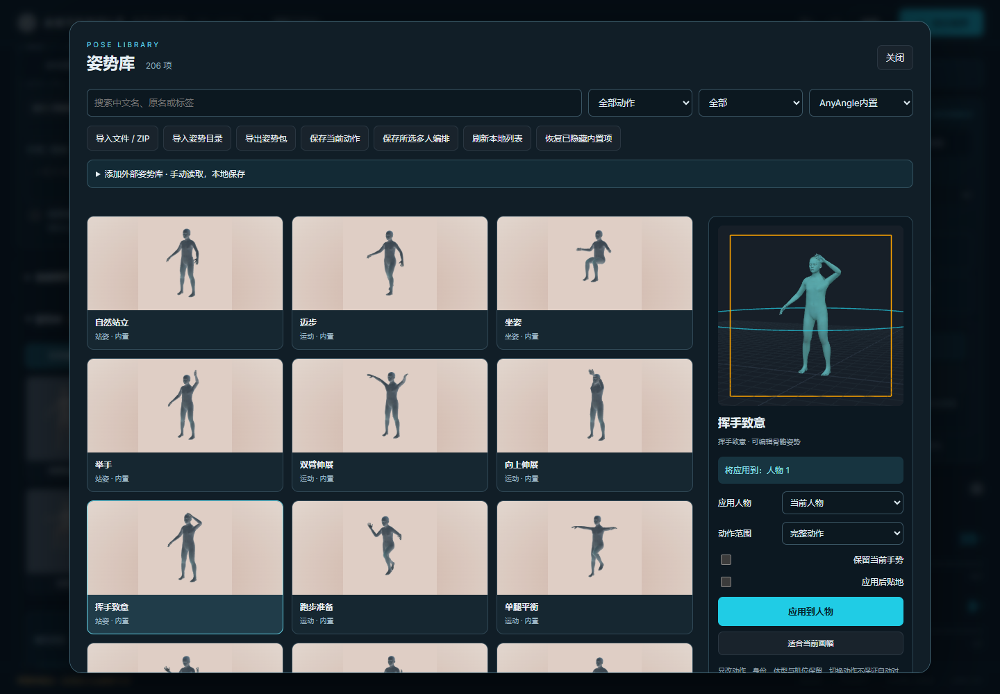

# v1.7.0 stability audit · 2026-10-20

This follow-up tested failure and repeated-operation paths in the local Windows/Chrome/ComfyUI environment. The frontend cache build is `20261020stable1`; the unreleased feature version remains 1.7.0. Existing workflows and the 191 imported source records remain intact.

## Reproduced and fixed

| Problem | Resulting behavior |
| --- | --- |
| Importing a complete built-in pack merged its entries into one extra user item; built-in names/favorites did not restore. | Known unchanged built-ins map back to their original IDs and preferences. A 15-entry built-in pack restores to 15 entries, without duplicates. Custom sources without file paths keep differently named actions separate. |
| Partial actions retained old bone translations; hand preservation dropped positional adjustments. | Matching translation channels are replaced along with rotations; untouched body parts and explicitly preserved hands retain their adjustments. |
| Pose application reset the grid before grounding; batches omitted the grounding option. Unused vertices outside the visible mesh index also distorted floor calculations. | Grounding retains the previous world floor, uses rendered skinned vertices, and is passed to every batch view. |
| An incompatible composition later in a mixed batch failed after earlier tasks had started. | Every chosen action is validated before the first submission; role-count errors disable execution in the batch dialog. |
| Quick repeated writes could produce revision conflicts; a delayed list response could overwrite a newer local catalog response. | Writes are guarded while pending, and older catalog revisions cannot replace newer ones. Import controls cannot start a competing write. |
| Closing during preview loading could leave the next opening stuck. | Reopening restarts the selected isolated preview. Hidden selections cannot remain actionable. |
| Blocking browser storage prevented opening the server catalog; non-JSON service errors produced parse errors. | Server catalog operations continue when browser storage is unavailable; failed responses produce readable messages and restore controls. |
| Counts stayed stale after some mutations; normalization warnings were discarded; an oversized preview could discard valid pose files. | Counts update with the catalog, compatibility warnings remain, and failed previews become per-entry diagnostics. Excessively nested JSON receives a controlled error without changing the catalog. |

## Verification

- **268 JavaScript tests** and **163 Python tests** passed. Added regressions first reproduced four backend assertion failures, one preview exception and two positional-mixing failures before their fixes. The indexed-mesh floor regression also uses a real skinned geometry with an unused vertex below its rendered triangle.
- **9 new real-browser stability checks** passed against the local ComfyUI endpoints: rapid writes, delayed reads, a non-JSON 503 response, blocked browser storage, canceled/reopened preview, grounding/undo, grounded pose-camera batching/restoration, repeated operations, and incompatible batch preflight.
- **20 apply/undo cycles** retained **8 geometries and 2 textures** in the main renderer. After settling, a two-second sample recorded **zero animation-frame callbacks**. This is a bounded renderer observation, not a guarantee about total system memory or all long-running workloads.
- In the real floor-seated case, grounding changed actor height by **−6.07296 world units**, while retaining the camera; undo restored the original scene exactly. The two-angle batch used the same grounded placement and restored the draft afterward.
- **18 body/pose geometry cases** passed using rendered-index surface vertices as the floor oracle. Maximum measured floor error was **9.83 × 10⁻⁸ world units**. This supersedes the earlier coarse bounding-box grounding measurement in the [initial validation](pose-library-validation.md).
- The existing **14 pose-library browser checks** passed again, including four guide outputs, eight distinct pose-camera captures, cancellation, identities/locks, shared catalog, migration and import/export. Existing guide/editor, responsive-layout and angle-preset regressions also passed.
- The complete **206-entry catalog** exported and restored to an empty store with matching source paths, original names and pose hashes; all 15 built-in IDs remained intact. The live source counts remain **55 + 50 + 58 + 16 + 12**. Four fresh **AnyAngleStudioT8 → SaveImage** executions succeeded, with maximum RGB difference **0** against each current browser guide capture.

No final Qwen image-quality claim follows from these tests. Contacts and intersections for arbitrary body proportions still require visual review. The audit establishes the tested behavior and recovery paths; it cannot establish absolute absence of bugs across every browser, device, plugin combination or input.

Raw before/after logs and receipts are local-only under `.local/research/stability-20261020/`. The shared library remains in `ComfyUI/input/anyangle_studio/pose_library`. Use the real service at `http://127.0.0.1:8192/`; the old 8194 address was an auxiliary development fixture.

