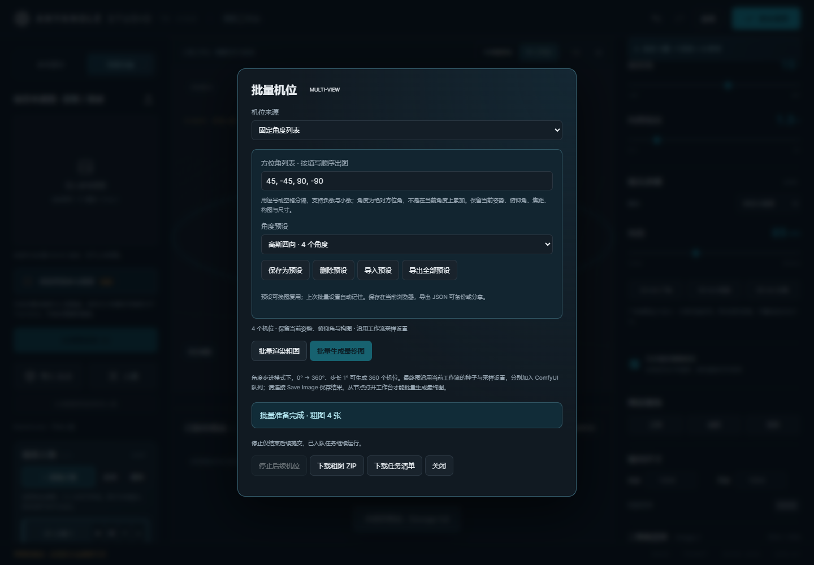

# v1.6.6 validation

Validated on 2026-10-11 using Windows, Node.js, the bundled Python runtime and headless Chrome.

## Fixed angles and reusable presets

- `node --test --test-reporter=spec tests/*.test.mjs`: **260 passed**, no failures or skips.
- `python -m unittest discover -s tests -p 'test_*.py'`: **130 passed**.
- The browser suite uses the actual editor modules and WebGL rendering, with local HTTP fixtures for snapshot storage and queue acknowledgements. It does not run Qwen inference.
- Rendered four distinct PNG guides at **45, -45, 90, -90**, preserving poses, elevation, focal length, framing and dimensions, then restoring the original camera.
- Verified preset save, delete, actual JSON download and file-picker import, duplicate-name numbering, reload persistence, invalid-import rejection and storage-failure recovery.
- Verified the embedded editor submits four distinct view snapshots in the requested order. Queue acknowledgements are fixtures; this check makes no claim about generated image quality.
- Checked the dialog at **1440, 390 and 320 px** with visible management controls and no horizontal overflow. The screenshot below is captured from the real editor.
- Existing range and camera-bookmark behavior remains covered by the regression suite. Existing responsive layout and guide-editor browser suites also passed during feature development.

The repeatable browser tests live in `tests/batch-presets-browser.mjs`, invoked by `tests/ui-browser.mjs`. Set `ANYANGLE_PLAYWRIGHT` and `ANYANGLE_CHROMIUM` for locally installed runtime paths, then run `node tests/ui-browser.mjs`.

## PR #7 review

[PR #7](https://github.com/T8mars/Comfyui-Qwen-Image-2.1-MultiAngle-T8/pull/7) proposed a loopback-only allowlist on Studio routes. The reviewed head was `bb5d058f4735909c40bd7908ed732cfd8b6a72c0`.

The exact reviewed guard was applied to the current route handlers in a temporary aiohttp test server. Tests made real HTTP requests through both loopback and the machine's LAN interface, using temporary asset storage and stubbed model discovery, without inference.

| Client | Current config / PNG upload / pose save | With proposed guard |
| --- | --- | --- |
| 127.0.0.1 | 200 / 200 / 200 | 200 / 200 / 200 |
| 192.168.2.133 | 200 / 200 / 200 | 403 / 403 / 403 |

The PR was declined with this evidence because it disables intentional LAN usage and does not implement identity authentication. Both READMEs now clarify the deployment boundary: Studio does not provide separate account authentication; access control for untrusted networks belongs at the entry point for the entire ComfyUI service. This review is not a claim that a ComfyUI server is safe to expose publicly without authentication.
